# Planner supervisor architecture

The supervisor separates **authorization**, **agent execution**, and **provenance**.
Python decides permissions; the OpenCode bridge waits for those decisions before
tools or supported model requests proceed.



Solid connections show implemented interfaces exercised by deterministic tests
or fixed OpenCode fixtures. The dashed launch connection and worker boundary
show required runtime integration awaiting Ubuntu acceptance. Normal autonomous
execution remains blocked; this is an architecture view, not a claim of a fully
confined deployment.

## Request flow

1. The operator reviews a TOML policy and approves exact grants, delegation
   templates, or narrow exceptions through the CLI.
2. A normal launcher must establish OS protection, boot a private OpenCode server
   without task data, and verify its hook registration before admitting a task.
   This runtime integration remains pending.
3. OpenCode's hook bridge sends worker-bound requests to the authenticated
   loopback broker. The broker checks current authority through the supervisor
   and admits actual model inputs through `ModelContext`.
4. OpenCode executes its built-in tools and sends native HTTP requests to the
   configured provider after admission. **The broker is a decision point, not a
   model-traffic proxy.** The OS backend must independently constrain tools,
   shell commands, and all descendants.
5. SQLite retains control records, origins, and permitted project notes. Read-only
   exports produce the offline report, which does not participate in enforcement.

## Components

| Component | Responsibility | Source |
| --- | --- | --- |
| CLI and supervisor | Policy review, grants, exceptions, delegation, durable execution and recovery records | [CLI](../planner/__main__.py), [supervisor](../planner/supervisor.py), [policy](../planner/policy.py) |
| Worker broker | Authenticated protocol, exact tool checks, refusal history, receipt binding | [transport](../planner/broker_server.py), [mediation](../planner/mediation.py) |
| Model context | Actual in-memory inputs, conservative origin/sensitivity propagation, opaque handles | [context](../planner/context.py) |
| OpenCode connector | Pinned release, private bootstrap proposal, blocking hooks, explicit provider configuration | [connector](../planner/connector.py), [hook bridge](../planner/opencode/bridge.mjs) |
| OS backend | Launch gate and required filesystem/process containment | [enforcement](../planner/enforcement.py) |
| Persistence and report | SQLite metadata, project memory, inspection and offline visualization | [provenance](../planner/provenance.py), [report](../planner/report.py) |
| Evaluation | Fresh matched fixtures and independent oracle behind the OS gate | [evaluation](../planner/evaluation.py) |

## Trust boundaries

- **Only the operator channel authorizes access.** Repository instructions,
  memories, tool output, and model text cannot approve grants or exceptions.
- **Workers cannot access supervisor-owned storage.** Keep the control database,
  memory metadata, active policy, and approval records outside worker access.
- **Tool approval and OS confinement serve different purposes.** A broker cannot
  intercept every file operation inside an arbitrary shell command. Descendant
  confinement, grant expiry, and cleanup must be enforced by the validated backend.
- **Content and provenance are separate.** Model request/response bytes remain
  ephemeral in this layer; origin and decision metadata persist. Sensitive-derived
  text cannot become a saved note. Harness-wide persistence still needs acceptance.
- **The report is observational.** Its edges record exposure, derivation,
  authorization, or lifecycle evidence; they do not prove causal influence or
  executed effects where evidence is absent.

Current platform failures, blocked transports, and the Ubuntu retest checklist are
in [known limitations](KNOWN_LIMITATIONS.md). Start with the
[planner README](../README.md) for commands.

## Editing the diagram

[Mermaid source](diagrams/architecture.mmd) is the editable source;
[SVG](diagrams/architecture.svg) is the checked-in rendering. Regenerate the SVG
with Mermaid CLI (rendered here with version 12.2.0) after changing the source:

```sh
mmdc -i docs/diagrams/architecture.mmd -o docs/diagrams/architecture.svg \
  -b white --size 1600 --no-font-embed
```

The renderer is documentation tooling, not a supervisor runtime dependency.
