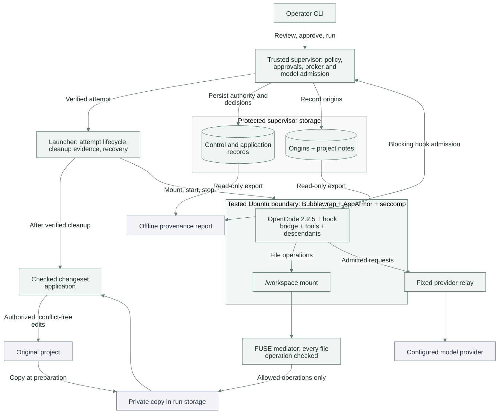

# Planner supervisor architecture

The supervisor owns permissions and provenance. On Ubuntu the launcher runs a
confined OpenCode worker over a FUSE-mediated private copy and applies checked
edits to the original project. The offline runner remains for plain commands.
See the [connected runtime](CONNECTED_RUNTIME.md) for the full sequence.

The diagram shows components and trust boundaries of the connected Ubuntu
runtime. Grey nodes are data or external systems; the green group is the jail.

## Offline command flow

1. The operator approves a policy and worker with the `shell` tool.
2. The runner checks current authority and copies permitted regular inputs into
   a private workspace. The original project is not mounted in the sandbox.
3. Bubblewrap, AppArmor and seccomp constrain the command and its descendants.
   The operator runner polls authority and stops on revocation or timeout.
4. Edits remain in the private copy for review and manual application. This
   mode does not create model-context or durable attempt records.

See [Ubuntu setup and restrictions](LINUX_SANDBOX.md) for the tested contract.

## Connected flow

1. The operator reviews a TOML policy and approves exact grants, delegation
   templates, or narrow exceptions through the CLI.
2. The launcher verifies the runtime, reserves approved exceptions, mounts the
   mediated copy, boots a private OpenCode server without task data inside
   Bubblewrap/AppArmor/seccomp, and verifies hook registration before the prompt.
3. OpenCode's hook bridge sends worker-bound requests to the authenticated
   loopback broker. The broker checks current authority through the supervisor
   and admits actual model inputs through `ModelContext`.
4. OpenCode executes its built-in tools inside the jail; the FUSE mediator checks
   every file operation by tools, shells and descendants against the same policy.
   Provider requests leave through a fixed relay after broker admission.
5. After verified cleanup the changeset applies authorized, conflict-free edits
   (or retains them in review mode) and records the outcome.
6. SQLite retains control records, origins, and permitted project notes. Read-only
   exports produce the offline report, which does not participate in enforcement.

## Components

| Component | Responsibility | Source |
| --- | --- | --- |
| CLI and supervisor | Policy review, grants, exceptions, delegation, durable execution and recovery records | [CLI](../planner/__main__.py), [supervisor](../planner/supervisor.py), [policy](../planner/policy.py) |
| Worker broker | Authenticated protocol, exact tool checks, refusal history, receipt binding | [transport](../planner/broker_server.py), [mediation](../planner/mediation.py) |
| Model context | Actual in-memory inputs, conservative origin/sensitivity propagation, opaque handles | [context](../planner/context.py) |
| OpenCode connector | Pinned release, private bootstrap proposal, blocking hooks, explicit provider configuration | [connector](../planner/connector.py), [hook bridge](../planner/opencode/bridge.mjs) |
| Launcher | Attempt lifecycle, exception reservation, cleanup evidence, recovery, application | [launcher](../planner/launcher.py) |
| Connected runtime | FUSE mediator, jail, relays, private server bootstrap | [mediator](../planner/native/mediatedfs.py), [runtime](../planner/native/confined_opencode.py) |
| Changeset | Checked application of files and directories with a progress journal | [changeset](../planner/changeset.py) |
| Generic live-project gate | Still refuses unconfined live-project commands | [enforcement](../planner/enforcement.py) |
| Ubuntu offline runner | Private input copy, kernel path rules, detached-descendant cleanup; no model network or automatic merge | [Linux sandbox](../planner/native/linux_sandbox.py) |
| Persistence and report | SQLite metadata, project memory, inspection and offline visualization | [provenance](../planner/provenance.py), [report](../planner/report.py) |
| Evaluation | Frozen matched fixtures, confined oracle, native/OS/supervisor collector | [evaluation](../planner/evaluation.py), [comparison](../planner/comparison.py) |

## Trust boundaries

- **Only the operator channel authorizes access.** Repository instructions,
  memories, tool output, and model text cannot approve grants or exceptions.
- **Workers cannot access supervisor-owned storage.** Keep the control database,
  memory metadata, active policy, and approval records outside worker access.
- **Tool approval and OS confinement serve different purposes.** A broker cannot
  intercept every file operation inside an arbitrary shell command. Descendant
  confinement, grant expiry, and cleanup must be enforced by the validated backend.
- **Content and provenance are separate.** Model request/response bytes remain
  ephemeral in this layer; origin and decision metadata persist. Sensitive-derived
  text cannot become a saved note. Harness-wide persistence still needs acceptance.
- **The report is observational.** Its edges record exposure, derivation,
  authorization, or lifecycle evidence; they do not prove causal influence or
  executed effects where evidence is absent.

Current platform restrictions, blocked transports and the integration checklist are
in [known limitations](KNOWN_LIMITATIONS.md). Start with the
[planner README](../README.md) for commands.

## Editing the diagram

The diagram above is Mermaid source embedded in this file; GitHub and most
Markdown viewers render it directly, so there is no separate image to regenerate.
